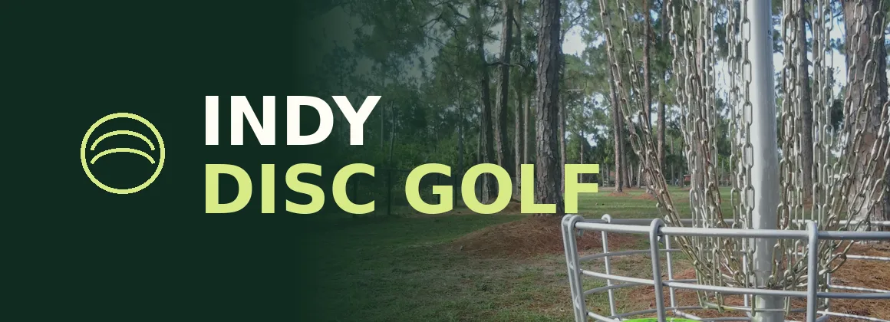

# Indy Disc Golf



A Django course directory and review app for the Indianapolis disc golf community. Browse by course name or city, see hole counts and tee surfaces, and create an account to add courses and write reviews.

## Try it locally

Use Python 3.12 or newer. Create and activate a virtual environment, then run:

```sh
python -m venv .venv
# macOS/Linux: source .venv/bin/activate
# Windows PowerShell: .venv\Scripts\Activate.ps1
python -m pip install -r requirements.txt
python manage.py migrate
python manage.py seed_demo
python manage.py runserver
```

Open [localhost:8000](http://localhost:8000/). Search for Sahm Park, open the course, then register and post a review. Staff accounts can archive and restore courses. Create a staff account locally with `python manage.py createsuperuser`.

## Development

Run `python manage.py test` and `python manage.py makemigrations --check --dry-run`. The app uses Django 5.2 LTS, Django authentication, and SQLite for local development. The deterministic demo command leaves existing course details alone.

For a hosted deployment, provide `DJANGO_SECRET_KEY`, set `DJANGO_DEBUG=false`, set `DJANGO_ALLOWED_HOSTS`, and configure HTTPS, production static and media serving, and persistent database storage. See the [Django deployment checklist](https://docs.djangoproject.com/en/5.2/howto/deployment/checklist/).

## Research and credits

- [Sahm Park course details](https://www.pdga.com/course-directory/course/sahm-park) and [official disc golf rules](https://www.pdga.com/rules/official-rules-disc-golf) from the Professional Disc Golf Association.
- Hero photo by Stephen James Hall. [Wikimedia Commons source and CC0 license](https://commons.wikimedia.org/wiki/File:Disc_Golf_Disc_in_Basket.jpg). Resized for web delivery and cropped on screen.

### Eleven Fifty Academy Blue Badge project (2019)

The original group project was built by Joshua Serie, Owen Edwards, and Patrick McGill. The links show each person's last recorded original contribution on the branch before the refresh.

| Contributor | Last recorded original commit |
| --- | --- |
| Joshua Serie | [March 25, 2019](https://github.com/jdserie/Disc-Golf/commit/c0514c5ca047740b4f0c8da751b2fb673399be77) |
| Owen Edwards | [March 27, 2019](https://github.com/jdserie/Disc-Golf/commit/aa0f1b1a7f5ffb1882e6995109c6235360a86af8) |
| Patrick McGill (PRMcGill) | [March 25, 2019](https://github.com/jdserie/Disc-Golf/commit/56a4cb7dfff6a7b43587e4fada529126fd6a33b5) |

### Portfolio refresh

Directed by Joshua Serie with AI-assisted research and development. The refresh added the responsive design and wordmark, upgraded Django, repaired and verified core workflows, and documented a reproducible demo.
